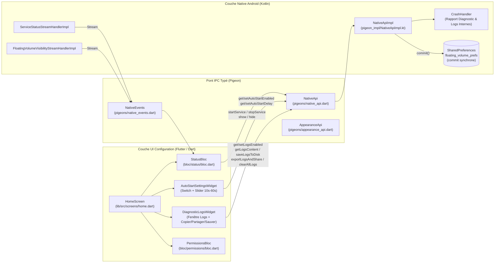
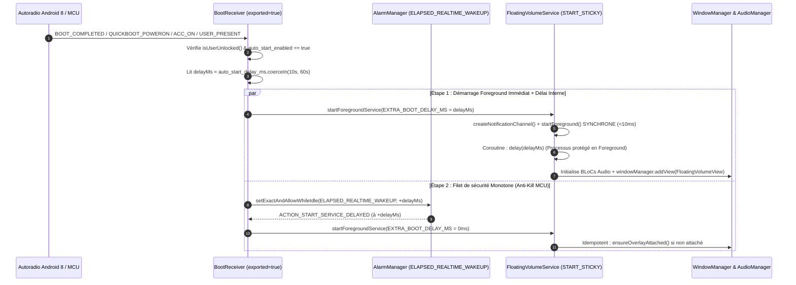
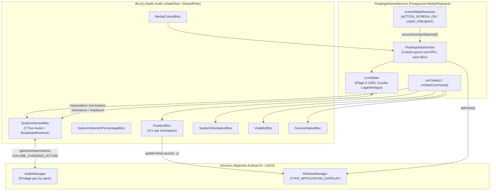

# Architecture Technique — Floating Volume (`v0.9.11+101`)

> **Cible Matérielle :** Autoradio / Tablette embarquée sous **Android 8.0/8.1 Oreo (API 26/27)** (souvent masqué en « Android 12+ » par les firmwares MCU chinois type FYT, Topway, MTCD, XYAuto) ainsi qu'Android Automotive OS (AAOS) jusqu'à Android 15 (`targetSdk = 35`).

Ce document décrit l'architecture complète de **Floating Volume**, structurée en deux chapitres distincts :
1. **Chapitre 1 : Architecture Flutter & Contrats Pigeon** (Interface de configuration, fenêtre de diagnostic embarquée et pont IPC typé).
2. **Chapitre 2 : Architecture Service Natif Android / Overlay & AudioManager** (Moteur autonome en arrière-plan, Auto-Start blindé, journalisation persistante et contrôle matériel du son).

---

## Chapitre 1 : Architecture Flutter & Contrats Pigeon

### 1.1. Rôle de la couche Flutter (`lib/`)
Dans la philosophie embarquée **Low-GPU / Automotive**, le moteur Flutter n'est utilisé **que pour l'écran de configuration ponctuel** (`MainActivity`). Dès que la bulle flottante est active, l'application Flutter peut être fermée : le service natif Kotlin tourne de manière 100 % autonome sans consommer de ressources GPU Flutter.

L'interface Flutter s'articule autour de trois `Bloc` principaux (`flutter_bloc`) et de deux widgets embarqués sur `HomeScreen` :
- **`permissions/bloc.dart`** : Vérifie et demande les 3 permissions critiques (`SYSTEM_ALERT_WINDOW`, `POST_NOTIFICATIONS`, `REQUEST_IGNORE_BATTERY_OPTIMIZATIONS`).
- **`status/bloc.dart`** : Écoute en temps réel les `EventChannel` Pigeon (`serviceStatus` et `floatingVolumeVisibility`) et déclenche `nativeApi.startService()` / `nativeApi.stopService()`.
- **`theme/bloc.dart`** : Gère le thème de l'interface de paramétrage (`Light`, `Dark`, `System`) persisté via `rx_shared_preferences`.
- **`AutoStartSettingsWidget` (`lib/src/screens/home.dart`)** : Pilote l'activation du démarrage automatique (`setAutoStartEnabled`) et le délai avant affichage de la bulle (`setAutoStartDelay`, borné strictement entre **10s et 60s**, soit `10000 ms` à `60000 ms`).
- **`DiagnosticLogsWidget` (`lib/src/screens/home.dart`)** : Fenêtre de diagnostic activable/désactivable (`setLogsEnabled`) affichant l'en-tête matériel réel de l'autoradio (`SDK_INT` réel vs version affichée, uptime monotone `elapsedRealtime`, état des permissions et préférences) ainsi que l'historique horodaté des événements de boot/service, avec boutons **Copier**, **Partager / Email** (`Intent.ACTION_SEND`), **Enregistrer (`Download/`)**, **Actualiser** et **Effacer**.

### 1.2. Diagramme de flux Flutter ↔ Pigeon ↔ Kotlin

### 1.3. Contrats Pigeon & Clés `SharedPreferences`

#### Méthodes exposées par `NativeApi` (`pigeons/native_api.dart`)
| Méthode | Signature Dart | Rôle côté Android (`NativeApiImpl.kt`) |
|---|---|---|
| `startService()` | `Future<void>` | Définit `isStoppingIntentionally = false`, trace l'événement et lance `FloatingVolumeService` via `startForegroundService()`. |
| `stopService()` | `Future<void>` | Définit `isStoppingIntentionally = true`, trace l'événement et arrête `FloatingVolumeService`. |
| `showFloatingVolume()` | `Future<void>` | Émet `VisibilityBloc.Event.Show`. |
| `hideFloatingVolume()` | `Future<void>` | Émet `VisibilityBloc.Event.Hide`. |
| `setAutoStartEnabled(bool)` | `Future<void>` | Sauvegarde `auto_start_enabled` + garantit `auto_start_delay_ms` (`10000..60000`) avec `.commit()` synchrone. |
| `getAutoStartEnabled()` | `Future<bool>` | Lit `auto_start_enabled` dans `floating_volume_prefs`. |
| `setAutoStartDelay(int)` | `Future<void>` | Sauvegarde `auto_start_delay_ms` (clampé `10000..60000`) avec `.commit()` synchrone. |
| `getAutoStartDelay()` | `Future<int>` | Lit `auto_start_delay_ms` (défaut `10000 ms`). |
| `setRestoreServiceState(bool)` | `Future<void>` | Sauvegarde `restore_service_state` avec `.commit()`. |
| `getRestoreServiceState()` | `Future<bool>` | Lit `restore_service_state`. |
| `setLogsEnabled(bool)` | `Future<void>` | Active/désactive l'enregistrement et l'affichage de la fenêtre de logs (`logs_enabled` via `.commit()`). |
| `getLogsEnabled()` | `Future<bool>` | Lit `logs_enabled` dans `floating_volume_prefs`. |
| `getLogsContent()` | `Future<String>` | Génère l'en-tête système temps réel + les 300 dernières lignes de `diagnostic_log_current.txt`. |
| `saveLogsToDisk()` | `Future<String>` | Écrit le rapport complet dans `/storage/emulated/0/Download/FloatingVolume_Log_<timestamp>.txt` et retourne le chemin. |
| `exportLogsAndShare()` | `Future<void>` | Ouvre le sélecteur Android (`ACTION_SEND` `text/plain`) avec le rapport en texte brut (`EXTRA_TEXT`) pour Email / Éditeurs de texte. |
| `clearAllLogs()` | `Future<void>` | Efface les fichiers de logs internes et externes. |

#### Stockage `SharedPreferences`
| Fichier XML | Clé | Type | Défaut | Description |
|---|---|---|---|---|
| `floating_volume_prefs` | `auto_start_enabled` | `Boolean` | `false` | Active le lancement automatique au démarrage / réveil MCU de la voiture. |
| `floating_volume_prefs` | `auto_start_delay_ms` | `Long` | `10000L` | Délai (`10000` à `60000` ms) avant l'affichage de la bulle flottante. |
| `floating_volume_prefs` | `last_service_state` | `Boolean` | `false` | État du service avant coupure (maintenu à `true` si tué par l'OS/MCU). |
| `floating_volume_prefs` | `logs_enabled` | `Boolean` | `false` | État d'ouverture de la fenêtre de diagnostic dans l'écran d'accueil. |
| `prefs` | `lastX_Portrait` / `lastY_Portrait` | `Int` | `-((screenWidth / 2) - 80)` / `0` | Coordonnées X/Y de la bulle en mode Portrait (placée par défaut à gauche pour ne jamais masquer l'interface de configuration). |
| `prefs` | `lastX_Landscape` / `lastY_Landscape` | `Int` | `-((screenWidth / 2) - 80)` / `0` | Coordonnées X/Y de la bulle en mode Paysage (Autoradio). |

---

## Chapitre 2 : Architecture Service Natif Android / Overlay & AudioManager

### 2.1. Séquence de Démarrage Automatique Blindée (Android 8 Oreo Head-Unit & AAOS)
Sur les autoradios Android 8 chinois (masqués en Android 12+), deux phénomènes matériels majeurs se produisent :
1. **Veille MCU (ACC OFF $\rightarrow$ ACC ON) :** Couper le contact ne fait pas toujours un Cold Boot ; le MCU tue les processus en arrière-plan à la coupure du contact, puis émet des broadcasts spécifiques au réveil (`QUICKBOOT_POWERON`, `ACC_ON`, `USER_PRESENT`, `SCREEN_ON`).
2. **Nettoyage mémoire au Cold Boot & Saut d'horloge GPS :** Durant les premières secondes suivant `BOOT_COMPLETED`, le MCU tue les processus qui ne sont pas en `ForegroundService`, et la synchronisation GPS/RDS fait sauter l'horloge système (`System.currentTimeMillis()`).

Pour garantir un démarrage à 100 %, `BootReceiver` et `FloatingVolumeService` implémentent une **stratégie à double détente** :

### 2.2. Architecture Réactive Interne du Service Natif (`FloatingVolumeService`)
Le service natif repose sur un `CoroutineScope(SupervisorJob() + Dispatchers.Main.immediate)` et des BLoCs Kotlin singletons (`StateFlow` / `SharedFlow`) :

### 2.3. Routage des 7 Flux Audio & Protection « Do Not Disturb » (DND)
Un clic sur l'icône de canal (`channelIv`) située au-dessus du `CoolSlider` émet `SystemVolumeBloc.Event.CycleStream`, faisant tourner manuellement les **7 canaux audio Android** :

1. `STREAM_MUSIC` (`3`) — Musique / Média (`ic_media_play`)
2. `STREAM_ALARM` (`4`) — Alarme / Guidage GPS (`ic_lock_idle_alarm`)
3. `STREAM_VOICE_CALL` (`0`) — Appel téléphonique (`stat_sys_phone_call`)
4. `STREAM_RING` (`2`) — Sonnerie (`ic_lock_silent_mode_off`)
5. `STREAM_SYSTEM` (`1`) — Système (`ic_dialog_info`)
6. `STREAM_NOTIFICATION` (`5`) — Notification (`ic_dialog_email`)
7. `STREAM_ACCESSIBILITY` (`10`) — Accessibilité / Guidage (`btn_star`)

> [!IMPORTANT] Comportement Matériel Identifié : Mode « Ne Pas Déranger » (DND)
> Lorsque le mode **Do Not Disturb (DND)** d'Android est activé sur l'autoradio, le système verrouille de force `STREAM_RING`, `STREAM_NOTIFICATION`, `STREAM_SYSTEM` et `USAGE_ASSISTANCE_NAVIGATION_GUIDANCE` (Waze) à `0`. Tous les appels à `AudioManager` dans `SystemVolumeBloc.kt` sont encapsulés dans des blocs `try-catch` stricts afin qu'aucune `SecurityException` liée au mode DND ne puisse interrompre les coroutines du service.

### 2.4. Garanties d'Interactivité UI & Isolation Tactile de l'Overlay (`v0.9.11`)
Afin que l'interface de configuration (`HomeScreen`) reste **100 % cliquable et réactive** même lorsque la barre flottante est activée (« ON ») :
1. **Enregistrement Pigeon Synchrone + `SupervisorJob` (`MainActivity.kt`)** : Les canaux Pigeon (`NativeApi`, `AppearanceApi`, `MediaApi`) et les `EventChannel` (`serviceStatus`, `floatingVolumeVisibility`) sont enregistrés **de manière synchrone** dès `configureFlutterEngine(flutterEngine)`, avant le premier `initState()` Dart, avec un `CoroutineScope(SupervisorJob() + Dispatchers.Main.immediate)` dédié qui ne s'annule jamais en cas d'exception isolée.
2. **Transitions d'état non bloquantes (`VisibilityBloc.kt` & `NativeApiImpl.kt`)** : `VisibilityBloc.show()` / `hide()` ne lèvent plus d'`IllegalStateException` si `FloatingVolumeService` est encore en cours d'initialisation asynchrone lorsque `StatusBloc` enchaîne `startService()` puis `showFloatingVolume()`.
3. **Isolation des flags `WindowManager.LayoutParams` (`FloatingVolumeService.kt`)** : L'overlay utilise strictement `LayoutParams.FLAG_NOT_FOCUSABLE` lorsqu'il est visible (et `FLAG_NOT_FOCUSABLE or FLAG_NOT_TOUCHABLE` lorsqu'il est masqué), sans `FLAG_LAYOUT_IN_SCREEN` ni `FLAG_LAYOUT_NO_LIMITS`, garantissant que seuls les pixels exacts de la barre capturent le toucher.
4. **Suppression de la boucle infinie de layout (`CoolSlider.kt`)** : `addOnLayoutChangeListener` ne déclenche `updateProgress()` que si la taille de la barre a réellement changé (`oldBottom - oldTop != bottom - top`), éliminant la saturation à 60 fps du Main Thread Android une fois la barre affichée.
